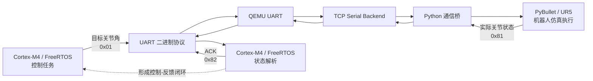

# 第1阶段：系统技术方案设计文档

## 1. 文档目的

本项目面向六轴工业机器人嵌入式运动控制固件开发与仿真验证，基于 ARM Cortex-M4、FreeRTOS、QEMU、Python 和 PyBullet 建立完整的软件开发与验证链路。

第1阶段主要完成系统总体架构设计、嵌入式基础工程、机器人仿真环境以及固件与仿真端之间的通信链路设计。

本文档用于明确：

- 系统总体软件架构；
- 驱动层、通信层、算法层和应用层的职责边界；
- Cortex-M4 / FreeRTOS 主控平台方案；
- PyBullet / UR5 仿真方案；
- 嵌入式端与仿真端之间的通信协议；
- 各模块之间的主要接口

---

## 2. 系统总体架构

系统由嵌入式控制端、通信链路和机器人仿真端三部分组成。



第1阶段搭建了上述固件、UART和仿真链路。后续阶段已在这套基础上增加运动请求接入、轨迹、IK和PID任务；当前完整的单关节QEMU串口闭环以 `docs/part5/03_uart_qemu_pybullet_contract.md` 与本机整改记录为准。TCP仅是QEMU UART的主机侧后端。

---

## 3. 软件分层设计

### 3.1 驱动层 / BSP

驱动层负责处理底层硬件资源，不直接理解机器人运动控制的业务语义。

当前涉及的底层资源包括：

- 系统时钟；
- GPIO；
- UART；
- Timer；
- 仿真电机驱动接口。

当前工程中已经建立：

```text
board_clock_init()
board_gpio_init()
uart_init()
uart_write()
uart_read_byte()
```

其中：

- `board_clock_init()` 提供系统时钟初始化接口；
- `board_gpio_init()` 提供 GPIO 初始化工程模板；
- UART 完成 Cortex-M4 与外部仿真环境之间的字节收发。

当前 QEMU 平台采用 `mps2-an386`，系统时钟按照 25 MHz 配置。

GPIO 部分在当前仿真平台主要完成工程接口和寄存器访问模板，用于保证 BSP 层结构完整；后续迁移实际 MCU 时，可在不修改上层接口的情况下替换底层实现。

第2阶段已为 UART、Timer、GPIO 和仿真电机驱动建立统一接口；实际平台迁移仍须实现并验证对应BSP。

---

### 3.2 通信层

通信层负责在嵌入式端与 Python 仿真端之间传输结构化数据。

其主要职责包括：

- 数据帧构造；
- 帧头同步；
- 命令类型识别；
- Payload 长度检查；
- 字节序转换；
- 数据校验；
- 六轴关节数据编码与解码。

通信层不直接操作机器人电机，也不负责运动学或轨迹规划。

当前通信接口由 `firmware/freertos_demo/communications/protocol.h` 定义，使用状态机逐字节处理可变长度Payload的帧：

```c
robot_status_t protocol_build_joint_target_frame(
    const robot_joint_angles_t *joints,
    uint8_t frame[PROTOCOL_JOINT_FRAME_LEN]
);

uint8_t protocol_parser_process_byte(
    protocol_parser_t *parser,
    uint8_t byte,
    protocol_frame_t *output_frame
);

robot_status_t protocol_parse_joint_state(
    const protocol_frame_t *frame,
    robot_joint_angles_t *joints
);
```

Python 端提供对应的数据帧构造、提取和解析逻辑。

---

### 3.3 应用层

应用层负责组织 FreeRTOS 任务，并协调通信层、驱动层及后续算法层。

当前应用层有通信任务和编译门控的运动任务：

| 任务 | 功能 | 当前周期 |
|---|---|---:|
| `ProtocolTX` | 周期发送目标/状态帧 | 配置默认1000 ms；运动测试构建按仿真需求配置 |
| `ProtocolRX` | UART中断唤醒，读取环形缓存并解析 | 事件驱动；残帧超时由JSON参数配置 |
| `Trajectory` | 关节及Cartesian轨迹采样 | 20 ms，Stage4门控 |
| `Control` | 反馈采样、PID及命令限幅 | 10 ms，Stage4门控 |
| `Monitor` | 故障、任务状态和栈水位监测 | 100 ms，Stage4门控 |

ProtocolTX和ProtocolRX均由FreeRTOS创建。Trajectory、Control和Monitor仅在`ROBOT_ENABLE_STAGE4_TASKS`打开时创建。

`ProtocolTX` 的基本流程：

```text
生成六轴目标角
      ↓
协议打包
      ↓
UART发送
```

`ProtocolRX` 的基本流程：

```text
UART接收字节
      ↓
识别帧头
      ↓
收满完整数据帧
      ↓
校验并解析
      ↓
返回状态确认帧
```

第4阶段已在应用层实现：

- 轨迹规划任务；
- PID闭环控制任务；
- 状态监测任务；
- 参数管理与异常处理。

---

### 3.4 算法层

算法层负责机器人运动控制相关计算，与底层硬件和通信方式解耦。

当前算法层包括：

```text
算法层
├── 正运动学
├── 逆运动学
├── 最优逆解选择
├── 关节空间轨迹规划
├── 笛卡尔空间轨迹规划
└── PID位置闭环控制
```

纯算法与应用任务分层编译；数学模块不依赖FreeRTOS。运动任务只有通过显式CMake门控才会进入测试固件。

第3、4阶段已实现上述运动学、选解、关节/Cartesian轨迹和PID模块。算法通过公共关节、位姿和错误码类型与应用层交互，不直接访问UART、GPIO等底层资源。

---

### 3.5 仿真层

仿真端采用：

- Python 3.11；
- PyBullet；
- UR5 六轴工业机器人 URDF 模型。

当前仿真工程主要负责：

- URDF 模型加载；
- Visual / Collision Mesh 加载；
- 六轴关节识别；
- 关节位置控制；
- 关节状态读取；
- 环境物体添加；
- 仿真视角切换；
- 与 Cortex-M4 控制端进行通信。

UR5 当前使用以下六个运动关节：

```text
shoulder_pan_joint
shoulder_lift_joint
elbow_joint
wrist_1_joint
wrist_2_joint
wrist_3_joint
```

仿真中采用 PyBullet `POSITION_CONTROL` 进行基础关节位置控制。

---

## 4. Cortex-M4 与实时操作系统方案

### 4.1 主控平台

当前采用：

```text
CPU架构：ARM Cortex-M4
QEMU Machine：mps2-an386
交叉编译器：arm-none-eabi-gcc
构建系统：CMake + Ninja
实时操作系统：FreeRTOS
开发环境：VS Code
```

在无实际 MCU 开发板的条件下，QEMU 用于运行 Cortex-M4 固件并模拟 UART 等基础资源。

---

### 4.2 启动流程

当前固件启动流程如下：

```text
Reset
  ↓
startup.s
  ↓
初始化 .data
  ↓
清零 .bss
  ↓
main()
  ↓
board_clock_init()
  ↓
board_gpio_init()
  ↓
uart_init()
  ↓
创建 FreeRTOS Tasks
  ↓
vTaskStartScheduler()
```

`startup.s` 同时配置 FreeRTOS 所需异常入口，包括：

- SVC；
- PendSV；
- SysTick。

---

### 4.3 构建方案

工程使用 CMake 管理 Cortex-M4 固件构建。

ARM 交叉编译 Toolchain 文件：

```text
cmake/arm-none-eabi-gcc.cmake
```

主要编译选项包括：

```text
-mcpu=cortex-m4
-mthumb
-ffreestanding
-fno-builtin
-nostdlib
```

链接过程使用工程自定义：

```text
linker.ld
```

最终生成：

```text
freertos_demo.elf
```

用于 QEMU 运行。

VS Code `tasks.json` 同时保留快速编译和运行任务，便于开发阶段操作。

---

## 5. 通信链路设计

### 5.1 链路结构

通信路径如下：

```text
Cortex-M4
   ↓
模拟 UART 寄存器
   ↓
QEMU
   ↓
TCP Serial Backend
127.0.0.1:5555
   ↓
Python Socket
   ↓
PyBullet
```

反方向使用同一条链路返回关节状态。

---

### 5.2 二进制帧格式

当前采用固定格式：

| 字段 | 长度 | 说明 |
|---|---:|---|
| Header | 2 Byte | 固定 `0xAA 0x55` |
| Command | 1 Byte | 消息类型 |
| Length | 1 Byte | Payload长度 |
| Payload | 12 Byte | 六个 `int16_t` 关节数据 |
| Checksum | 1 Byte | 字节和校验 |

完整帧长度：

```text
17 Byte
```

结构：

```text
+--------+---------+--------+-------------+----------+
| Header | Command | Length |   Payload   | Checksum |
+--------+---------+--------+-------------+----------+
| 2 Byte | 1 Byte  | 1 Byte |   12 Byte   | 1 Byte   |
+--------+---------+--------+-------------+----------+
```

---

### 5.3 字节序与角度表示

多字节数据采用 Little Endian。

关节角采用：

```text
signed int16
单位：0.01°
```

例如：

```text
60.00° -> 6000
10.00° -> 1000
-45.00° -> -4500
```

这样能够避免 Cortex-M4 与 Python 之间直接传输浮点数时产生的平台表示差异。

---

### 5.4 Command定义

| Command | 名称 | 方向 | 说明 |
|---:|---|---|---|
| `0x01` | `SET_JOINT_TARGETS` | Cortex-M4 → Python | 下发六轴目标角 |
| `0x81` | `JOINT_STATE` | Python → Cortex-M4 | 上报六轴实际角度 |
| `0x82` | `JOINT_STATE_ACK` | Cortex-M4 → Python | 确认状态帧已成功解析 |

---

### 5.5 Checksum

Checksum计算范围：

```text
Command + Length + Payload
```

不包含：

```text
0xAA 0x55
```

计算方式：

```text
checksum =
    (所有参与字段字节之和) & 0xFF
```

该校验方式用于第1阶段基础连通性验证。

当前通信继续使用协议定义的8位累加校验；更强校验算法须通过协议版本兼容和错误注入测试后再变更。

---

## 6. 仿真控制方案

Python 通信桥解析 `0x01` 后，将六轴目标角从 degree 转换为 rad，并使用：

```python
p.setJointMotorControlArray(...)
```

向 UR5 六个关节下发位置控制目标。

当前使用的最大控制力矩配置为：

```text
Joint 1：150
Joint 2：150
Joint 3：150
Joint 4：28
Joint 5：28
Joint 6：28
```

仿真循环约以：

```text
240 Hz
```

运行。

Python 每：

```text
0.2 s
```

读取一次六轴实际关节位置，并通过 `0x81 JOINT_STATE` 返回 Cortex-M4。

---

## 7. 模块接口关系

系统各层之间的主要数据关系如下：

```text
应用层
  │
  │ 六轴目标角
  ▼
通信层
  │
  │ 二进制帧
  ▼
UART驱动
  │
  ▼
QEMU / Python
  │
  ▼
PyBullet
  │
  │ 六轴实际角度
  ▼
通信层
  │
  ▼
应用层
```

各层遵循以下原则：

1. 驱动层只负责硬件访问；
2. 通信层只负责数据编码、解析和校验；
3. 算法层只负责运动控制计算；
4. 应用层负责模块组织和任务调度；
5. 仿真端作为机器人本体和传感反馈的替代环境；
6. 模块之间通过明确接口传递数据，避免跨层直接访问。
