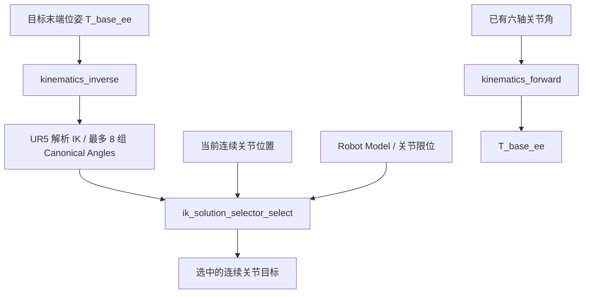

# 第3阶段：运动学算法推导与嵌入式适配文档

## 1. 文档目的

本文档用于说明六轴工业机器人嵌入式运动控制项目第3阶段完成的 UR5 运动学算法及其在 ARM Cortex-M4 平台上的实现方式。

根据项目任务书，第3阶段主要完成：

- 基于经典 UR5 的 DH 参数建立六轴连杆坐标系与齐次变换关系；
- 推导正运动学（Forward Kinematics，FK）与解析逆运动学（Inverse Kinematics，IK）；
- 使用 C 语言及标准数学库实现 FK / IK 求解接口；
- 根据关节总行程、限位裕量和奇异风险筛选 IK 候选解；
- 在 QEMU Cortex-M4 与 Python Robotics Toolbox 对照下验证精度和算法性能。

本文档主要明确各模块的职责、数学模型、核心 C 接口、数据单位、错误码、选解规则和嵌入式适配边界。精度与性能原始数据见同目录 `02_algorithm_validation_report.md`。


---

## 2. 运动学软件模块结构

第3阶段代码主要位于：

```text
firmware/freertos_demo/
├── common/
│   ├── robot_types.h
│   └── error_code.h
├── model/
│   ├── robot_model.h
│   └── ur5_model.c
├── algorithms/
│   ├── math/
│   │   ├── matrix4.h
│   │   └── matrix4.c
│   ├── kinematics/
│   │   ├── kinematics.h
│   │   ├── kinematics_forward.c
│   │   ├── kinematics_inverse.c
│   │   ├── kinematics_common.c
│   │   ├── kinematics_internal.h
│   │   ├── kinematics_private.h
│   │   └── ur5_analytic_ik.c
│   └── motion/
│       ├── motion_limits.h
│       ├── motion_limits.c
│       ├── ik_solution_selector.h
│       └── ik_solution_selector.c
└── tests/
    ├── kinematics/
    ├── motion/
    ├── host/
    └── qemu_target/
```

模块分工如下：

| 模块 | 主要文件 | 主要职责 |
|---|---|---|
| Robot Model | `model/ur5_model.c` | 保存 DH 参数、坐标系固定变换和关节行程限位 |
| Matrix4 | `algorithms/math/matrix4.c` | 4×4 矩阵运算 |
| FK Solver | `algorithms/kinematics/kinematics_forward.c` | 关节角 → 末端位姿齐次矩阵 |
| IK Solver | `algorithms/kinematics/kinematics_inverse.c`、`ur5_analytic_ik.c` | 末端位姿 → 最多 8 组几何逆解 |
| Kinematics Common | `algorithms/kinematics/kinematics_common.c` | 角度量化、规范化、解集去重、坐标转换 |
| Motion Limits | `algorithms/motion/motion_limits.c` | 连续角展开与关节行程判定 |
| IK Selector | `algorithms/motion/ik_solution_selector.c` | 跨候选解评分，选择连续关节目标 |

调用关系：



在第3阶段，图中最后的连续关节目标**尚未接入**完整轨迹规划、PID 和 Motor Driver 执行流程。

---

## 3. 公共数据类型与错误码

### 3.1 六轴关节角

机器人关节数量由 `common/robot_types.h` 统一定义：

```c
#define ROBOT_JOINT_COUNT 6U
```

对外运动学接口使用：

```c
typedef int16_t robot_joint_angle_t;

typedef struct
{
    robot_joint_angle_t value[ROBOT_JOINT_COUNT];
} robot_joint_angles_t;
```

单位与合法区间：

```text
1 unit = 0.01 degree
Canonical Angle = [-180.00°, 180.00°)
```

连续关节位置使用：

```c
typedef int32_t robot_joint_position_t;

typedef struct
{
    robot_joint_position_t value[ROBOT_JOINT_COUNT];
} robot_joint_positions_t;
```

连续位置同样采用 `0.01°`，但保存累计圈数，不在 ±180° 处回绕。例如 `+190°` 的连续位置为 `19000`，相应规范角为 `-17000`。

运动学内部数学计算统一采用：

```c
typedef float robot_real_t;
```

### 3.2 末端位姿与矩阵约定

公共齐次变换矩阵为：

```c
typedef struct
{
    robot_real_t matrix[4][4];
} robot_transform_t;
```

采用行优先存储；左上角 3×3 为旋转矩阵，右侧前三项为平移量（mm）。公共语义是 `base_link` 到 `ee_link` 的 `T_base_ee`。**标准 DH 的 `T_0_6` 不直接向上层暴露**。

### 3.3 统一错误码

全部公开算法接口使用 `robot_status_t`，成功返回 `ROBOT_STATUS_OK = 0`，失败返回负数。

| 状态码 | 含义及当前典型来源 |
|---|---|
| `ROBOT_STATUS_OK` | 求解成功 |
| `ROBOT_STATUS_ERROR_NULL_POINTER` | 输入/输出指针为空 |
| `ROBOT_STATUS_ERROR_INVALID_ARGUMENT` | 候选数量或规范角非法 |
| `ROBOT_STATUS_ERROR_OUT_OF_RANGE` | 当前连续位置越限 |
| `ROBOT_STATUS_ERROR_NO_SOLUTION` | 几何不可达或不存在合法连续角候选 |
| `ROBOT_STATUS_ERROR_SINGULAR` | 相关分支/候选触发当前处理的奇异条件 |
| `ROBOT_STATUS_ERROR_INTERNAL` | 机器人静态模型配置等内部问题 |

接口原则为：上层必须处理失败返回码，不能把空逆解集合或失败的选解结果直接传入控制链。

---

## 4. UR5 DH 参数与坐标系变换

经典 UR5 与 UR5e 的 DH 参数不同。本阶段使用仓库 `model/ur5_model.c` 的经典 UR5 参数，与任务书所指的 UR5 对应。参数来源参考：[Universal Robots DH 参数资料](https://www.universal-robots.com/articles/ur/application-installation/dh-parameters-for-calculations-of-kinematics-and-dynamics/)。工程中可直接复核 `dh_a_mm`、`dh_d_mm` 和 `dh_alpha_rad`。

### 4.1 连杆坐标系定义

使用 **标准（Classic）DH** 约定：关节 $i$ 的旋转轴取为坐标系 $\{i-1\}$ 的 $z_{i-1}$ 方向；$x_i$ 沿相邻关节轴的公法线方向；$y_i$ 按右手定则确定。四个参数含义为：

- $\theta_i$：绕 $z_{i-1}$ 的关节旋转角；
- $d_i$：沿 $z_{i-1}$ 的轴向平移；
- $a_i$：沿 $x_i$ 的连杆长度；
- $\alpha_i$：绕 $x_i$ 的连杆扭转角。

从第 $i-1$ 坐标系到第 $i$ 坐标系的变换顺序为

$$
{}^{i-1}T_i=R_z(\theta_i)\,T_z(d_i)\,T_x(a_i)\,R_x(\alpha_i).
$$

### 4.2 经典 UR5 DH 参数表

固件长度单位为 **mm**，角度计算单位为 **rad**。

| 关节 $i$ | $a_i$（mm） | $d_i$（mm） | $\alpha_i$（rad） | $\theta_i$ |
|---:|---:|---:|---:|---|
| 1 | 0 | 89.159 | $+\pi/2$ | $q_1$ |
| 2 | -425.000 | 0 | 0 | $q_2$ |
| 3 | -392.250 | 0 | 0 | $q_3$ |
| 4 | 0 | 109.150 | $+\pi/2$ | $q_4$ |
| 5 | 0 | 94.650 | $-\pi/2$ | $q_5$ |
| 6 | 0 | 82.300 | 0 | $q_6$ |

这些数值在 `model/ur5_model.c` 中由 `dh_a_mm`、`dh_d_mm`、`dh_alpha_rad` 保存。它们与 **UR5e** 参数不同，型号必须严格区分。

### 4.3 正运动学齐次矩阵公式

记 $c_i=\cos\theta_i$、$s_i=\sin\theta_i$、$c_{\alpha_i}=\cos\alpha_i$、$s_{\alpha_i}=\sin\alpha_i$，则按上述四个基本变换矩阵相乘得到

$$
{}^{i-1}T_i=
\begin{bmatrix}
 c_i & -s_i c_{\alpha_i} & s_i s_{\alpha_i} & a_i c_i\\
 s_i & c_i c_{\alpha_i} & -c_i s_{\alpha_i} & a_i s_i\\
 0 & s_{\alpha_i} & c_{\alpha_i} & d_i\\
 0 & 0 & 0 & 1
\end{bmatrix}.
$$

各矩阵的左上 $3\times3$ 部分为旋转矩阵 $R$，最右侧前三个值为位移向量 $p$。相邻变换逐次相乘，得到标准 DH 末端变换

$$
T_{0,6}={}^{0}T_1\,{}^{1}T_2\,{}^{2}T_3\,{}^{3}T_4\,{}^{4}T_5\,{}^{5}T_6
=\begin{bmatrix}R_{0,6}&p_{0,6}\\\mathbf{0}_{1\times3}&1\end{bmatrix}.
$$

固件的 `kinematics_build_dh_transform()` 构造单节变换，`matrix4_multiply()` 按关节顺序累乘。相对手工展开最终十六个元素的长表达式，逐矩阵相乘更易维护、核对和更换模型。

### 4.4 标准 DH 与公共坐标系的转换

标准 DH 末端不是项目公开的 `ee_link`。固件采用与 PyBullet URDF 匹配的接口：**`base_link` → `ee_link`**，其矩阵为

$$
T_{\mathrm{base,ee}}=B\,T_{0,6}\,E,
$$

其中当前模型的基座转换与工具端转换为

$$
B=\begin{bmatrix}-1&0&0&0\\0&-1&0&0\\0&0&1&0\\0&0&0&1\end{bmatrix},\qquad
E=\begin{bmatrix}0&-1&0&0\\0&0&-1&0\\1&0&0&0\\0&0&0&1\end{bmatrix}.
$$

IK 必须先转换回 DH 坐标系：

$$
T_{0,6}=B^{-1}\,T_{\mathrm{base,ee}}\,E^{-1}.
$$

若忽略 $B$ 或 $E$，即使标准 DH 数学计算正确，与 PyBullet `base_link/ee_link` 的对比仍会出错。这也是跨工具验证必须统一坐标约定的原因。

---

## 5. Forward Kinematics（FK）

### 5.1 模块职责

FK 接收六个关节的 Canonical Angles，构造六个单节 DH 变换并连乘，最后转换为公共 `T_base_ee`。

### 5.2 核心接口

位于 `algorithms/kinematics/kinematics.h`：

```c
robot_status_t kinematics_forward(
    const robot_joint_angles_t *joints,
    robot_transform_t *transform
);
```

| 参数 | 类型 | 含义 |
|---|---|---|
| `joints` | `const robot_joint_angles_t *` | 六轴规范角，单位 0.01° |
| `transform` | `robot_transform_t *` | 末端 4×4 齐次矩阵，平移单位 mm |
| 返回值 | `robot_status_t` | 成功返回 `ROBOT_STATUS_OK`，空指针报错 |

### 5.3 运算流程

```text
6 x Canonical Angles (int16_t, 0.01°)
    ↓ 角度换算到 rad
读取 Robot Model 的 DH 参数
    ↓
逐关节生成 ^(i-1)T_i
    ↓
T_0_6 = T_01 × T_12 × ... × T_56
    ↓
T_base_ee = B × T_0_6 × E
    ↓
4 x 4 robot_transform_t
```

代码由 `kinematics_forward.c` 与 `matrix4.c` 实现。矩阵乘法使用定长临时对象，并支持结果与输入对象别名重合，不需要为每一级变换调用动态内存分配。

---

## 6. Inverse Kinematics（解析 IK）

### 6.1 模块职责与最多 8 组逆解

IK 输入 `T_base_ee`，首先转换为 DH 坐标系的 `T_0_6`，再按两组肩部分支、两组腕部分支及两组肘部分支求解。理论组合为：

```text
Shoulder × Wrist × Elbow
   2     ×   2   ×   2   = 8
```

八组是候选上限，不表示每一个末端位姿必有八个有效解。不可达、奇异分支与量化去重都会减少实际解数。IK 返回的是**几何候选规范角**；行程限位过滤由 Motion Limits / IK Selector 负责。

### 6.2 Shoulder：求解 $q_1$

把目标末端 DH 齐次矩阵写为 $T_{0,6}=[R\ p;0\ 1]$，其中 $R$ 第三列为 $z_6=(r_{13},r_{23},r_{33})^\top$。扣除末端偏置 $d_6$，得腕部参考点在基座 $xy$ 面的投影

$$w_x=p_x-d_6r_{13},\qquad w_y=p_y-d_6r_{23}.$$

记 $\rho^2=w_x^2+w_y^2$，在当前 UR5 几何关系下，当 $\rho^2<d_4^2$（超过数值容差）时不可达。否则定义

$$\phi=\operatorname{atan2}(w_y,w_x),\qquad
\beta=\operatorname{atan2}(d_4,\sqrt{\rho^2-d_4^2}),$$

得到

$$q_1^{(1)}=\operatorname{wrap}(\phi+\beta),\qquad
q_1^{(2)}=\operatorname{wrap}(\phi+\pi-\beta).$$

实现：`ur5_analytic_ik_solve_q1_candidates()`。

### 6.3 Wrist：求解 $q_5$

对每个 $q_1$ 分支，根据 UR5 的 DH 几何得到

$$c_5=\cos q_5=\frac{p_x\sin q_1-p_y\cos q_1-d_4}{d_6}.$$

若 $c_5$ 明显超出 $[-1,1]$ 则该分支不可达。允许的小幅数值越界被夹紧到合法范围。代码利用旋转矩阵元素计算 $|\sin q_5|$，避免在 $c_5\approx\pm1$ 时直接计算 $\sqrt{1-c_5^2}$ 造成的消减误差：

$$u=r_{11}\sin q_1-r_{21}\cos q_1,\qquad
v=-r_{12}\sin q_1+r_{22}\cos q_1,$$

$$s_{5,\mathrm{abs}}=\sqrt{u^2+v^2},\qquad
q_5^{(\pm)}=\operatorname{atan2}(\pm s_{5,\mathrm{abs}},c_5).$$

实现：`ur5_analytic_ik_solve_q5_candidates()`。

### 6.4 Wrist：恢复 $q_6$

对已确定的 $q_1,q_5$，当 $|\sin q_5|$ 太小时，$q_4,q_6$ 发生耦合，当前解析分支无法唯一恢复 $q_6$，直接返回 `ROBOT_STATUS_ERROR_SINGULAR` 并跳过相应分支。

在非奇异分支中，令 $\sigma=\operatorname{sign}(\sin q_5)$，则

$$q_6=\operatorname{atan2}\bigl(
\sigma(-r_{12}\sin q_1+r_{22}\cos q_1),
\sigma(r_{11}\sin q_1-r_{21}\cos q_1)
\bigr).$$

实现：`ur5_analytic_ik_solve_q6()`。

### 6.5 Elbow：求解 $q_3$

由已知 $q_1,q_6$ 和末端矩阵扣除腕部几何偏置，计算肩肘平面中的等效坐标 $(u,v)$。当前代码在 `ur5_analytic_ik_compute_p13()` 中执行该坐标恢复，包含 $d_1,d_5,d_6$ 项，而不是把腕部视为零偏置。

以二连杆平面几何为基础，令 $a_2,a_3$ 为 DH 连杆长度：

$$c_3=\frac{u^2+v^2-a_2^2-a_3^2}{2a_2a_3}.$$

若 $|c_3|>1$（超出容差），该分支不可达。否则有

$$q_3^{(\pm)}=\operatorname{atan2}\bigl(\pm\sqrt{\max(0,1-c_3^2)},c_3\bigr).$$

这两个符号对应肘部的两种几何构型。实现：`ur5_analytic_ik_solve_q3_candidates()`。

### 6.6 Shoulder Lift：恢复 $q_2$

对每个有效 $q_3$，定义

$$A=a_2+a_3\cos q_3,\qquad C=a_3\sin q_3.$$

则按当前代码的平面坐标约定：

$$\boxed{q_2=\operatorname{atan2}(Av-Cu,\;Au+Cv)}.$$

当 $u^2+v^2$ 太小，当前实现判为奇异分支。实现：`ur5_analytic_ik_solve_q2()`。

### 6.7 Wrist 1：恢复 $q_4$ 与解集组合

由目标旋转矩阵与已知 $q_1,q_2,q_3,q_5,q_6$ 恢复腕一轴方向。源码计算两个方向分量 $x_{04,x},x_{04,y}$，并用 $q_{23}=q_2+q_3$ 得到

$$q_4=\operatorname{atan2}(\cos q_{23}\,x_{04,y}-\sin q_{23}\,x_{04,x},\;
\cos q_{23}\,x_{04,x}+\sin q_{23}\,x_{04,y}).$$

方向分量的平方范数过小时判定相应分支奇异。组合后的六轴角统一转回规范区间 $[-180^\circ,180^\circ)$，再量化为 $0.01^\circ$ 并去除重复结果。

实现：`ur5_analytic_ik_solve_q4()`、`kinematics_build_joint_solution()`、`kinematics_add_solution_if_unique()`。

### 6.8 核心接口和异常返回

```c
robot_status_t kinematics_inverse(
    const robot_transform_t *transform,
    kinematics_ik_solutions_t *solutions);
```

- `ROBOT_STATUS_OK`：至少找到一组有效解析候选解；
- `ROBOT_STATUS_ERROR_NO_SOLUTION`：目标无法得到解析解；
- `ROBOT_STATUS_ERROR_SINGULAR`：当前所有可达分支都陷入未处理的奇异情况；
- `ROBOT_STATUS_ERROR_NULL_POINTER` 等：输入或内部计算异常。

当前实现支持**跳过一个奇异分支，继续寻找其他可用分支**；不能将其误述为已经全面处理所有数学奇异位形。

### 6.9 逆解模块内部调用关系

```text
kinematics_inverse()
   ├── Public T_base_ee → DH T_0_6
   ├── solve_q1_candidates()          两组 Shoulder
   ├── solve_q5_candidates()          两组 Wrist
   ├── solve_q6()                    恢复 Wrist 3
   ├── solve_q3_candidates()          两组 Elbow
   ├── solve_q2()                    恢复 Shoulder Lift
   ├── solve_q4()                    恢复 Wrist 1
   ├── canonical angle quantization
   └── duplicate removal            最多 8 组
```

当前实现对某些奇异分支采取跳过处理，不通过任何虚构的“奇异补解”填充八组解。`kinematics_inverse()` 返回 `OK` 仅表明至少存在一组当前可计算的几何候选。

---

## 7. Motion Limits 与 IK 最优解选择

### 7.1 关节行程限位

来源：`model/ur5_model.c` 中与项目所用 URDF 一致的当前模型约束。

| 关节 | 下限 | 上限 |
|---|---:|---:|
| J1 | -360° | +360° |
| J2 | -360° | +360° |
| J3 | -180° | +180° |
| J4 | -360° | +360° |
| J5 | -360° | +360° |
| J6 | -360° | +360° |

这些是**项目仿真模型约束**，不可直接替代实物的安全限位。上下界均包含边界。

### 7.2 Canonical Angle 到 Continuous Position

对每个候选规范角 $q_i^{\mathrm{can}}$，寻找满足模型限位的整数圈数 $k$：

$$q_i^{\mathrm{cont}}=q_i^{\mathrm{can}}+360^\circ k,\quad
q_i^{\min}\le q_i^{\mathrm{cont}}\le q_i^{\max}.$$

在所有合法 $k$ 中选择距离当前连续位置 $q_i^{\mathrm{cur}}$ 最近的值。该逻辑由 `motion_limits_unwrap_nearest()` 完成，使用 `int64_t` 处理差值和圈数边界，避免 32 位整数中间计算溢出。

例：当前 J1 为 $+175^\circ$，候选规范角是 $-170^\circ$，应该展开为 $+190^\circ$，实际只转 $15^\circ$，而不是机械地转 $345^\circ$。

### 7.3 总行程、限位边界与奇异风险评分

新增的 `ik_solution_selector_select()` 接收 IK 候选解和当前位置，并按以下流程处理：

1. 校验候选解数量（1～8）、规范角范围及当前位置的连续行程是否合法。
2. 对每组候选执行 `motion_limits_unwrap_nearest()`；不能展开为合法位置的候选被剔除。
3. 根据 $|\sin q_3|$、$|\sin q_5|$ 评价肘部及腕部奇异风险。**当前硬阈值**为 $|\sin q|<0.01$；**软惩罚阈值**为 $|\sin q|<0.25$。
4. 计算每个关节的相对位移占可用行程比例，并对接近上下限的候选施加惩罚。
5. 按加权分数排序，平分时选总行程更短者，再平分保留候选顺序靠前者。

当前评分公式的简写为

$$
J=\sum_{i=1}^6\frac{|q_i^\mathrm{target}-q_i^\mathrm{current}|}{q_i^\max-q_i^\min}
+0.35\sum_{i=1}^6P_\mathrm{limit}(i)
+0.50\bigl[P_\mathrm{sing}(q_3)+P_\mathrm{sing}(q_5)\bigr].
$$

其中

$$
P_{\mathrm{limit}}(i)=\max\left(0,\frac{0.10-m_i/\Delta_i}{0.10}\right),\quad
m_i=\min(q_i-q_i^\min,q_i^\max-q_i),\quad \Delta_i=q_i^\max-q_i^\min,
$$

$$P_\mathrm{sing}(q)=\max\left(0,\frac{0.25-|\sin q|}{0.25}\right).$$

输出为连续位置、候选索引、总行程、最小限位裕量和加权评分。

**设计边界**：该启发式未使用完整雅可比条件数或奇异值分解，**不能独立检查肩部奇异性**，也不等于碰撞、轨迹、动力学及硬件安全验证。权重 0.35/0.50 是初始工程选取值，尚非标定后的最优参数。

### 7.4 选择器核心接口

文件：`algorithms/motion/ik_solution_selector.h`。

```c
robot_status_t ik_solution_selector_select(
    const kinematics_ik_solutions_t *solutions,
    const robot_joint_positions_t *current_positions,
    ik_selection_result_t *result
);
```

| 输入/输出 | 类型 | 说明 |
|---|---|---|
| `solutions` | `kinematics_ik_solutions_t *`（只读） | IK 返回的 1～8 组候选角 |
| `current_positions` | `robot_joint_positions_t *`（只读） | 当前六轴连续角 |
| `result` | `ik_selection_result_t *` | 选中连续目标、原候选索引、行程、限位裕量与评分 |

若无符合限位的等价角，返回 `ROBOT_STATUS_ERROR_NO_SOLUTION`；若存在限位可行角但全部触发当前硬奇异阈值，返回 `ROBOT_STATUS_ERROR_SINGULAR`。失败不覆盖已有输出。

目前的权重与阈值是用于仿真阶段的**启发式初始参数**，并非实物安全认证或全雅可比奇异性分析。

---

## 8. 嵌入式实现与适配说明

| 方面 | 当前实现 | 验证范围与剩余工作 |
|---|---|---|
| 数据类型 | 核心几何计算使用 `float`，角度对外采用定点表示 | 已在 ARM 构建与精度测试中使用 |
| 三角函数 | `sinf`、`cosf`、`atan2f` 等标准 C 数学库 API | 依赖 ARM 交叉工具链提供 `libm` |
| 内存 | 最大 8 个逆解，结构与中间矩阵为定长对象，无需算法堆分配 | 已测整固件 `text/data/bss`；**未测最大栈深度** |
| 数值稳定性 | 对余弦反解参数做容差检查与夹紧；使用矩阵方向量计算 $|\sin q_5|$ | 已通过有限样本精度验证，不能证明覆盖所有病态输入 |
| 计算流程 | 逐层淘汰不可行 IK 分支，并对重复解做去重 | 已实现；尚未完成基于硬件计数器的真实性能分析 |
| 平台边界 | `algorithms/` 不依赖 FreeRTOS、UART 或 PyBullet | 可以被将来的轨迹层调用，但还未成为实际运动执行路径 |

需要进一步优化的事项：正式 MCU 型号确定后，用真实硬件计时与栈水位测试验证实时性；建立全雅可比奇异指标或肩部独立判定；扩大边界与不可达输入覆盖范围；根据运动任务确定选解权重。

需要进一步区分**静态内存占用**和**最坏运行时栈深度**：

- `arm-none-eabi-size` 可以测 ELF 的 `text/data/bss`，不能直接得出算法单函数 RAM 峰值；
- 当前算法以定长结构、自动局部变量、分支淘汰减少不必要计算；
- 需要在真实目标芯片上结合 `-fstack-usage`、链接映射与运行时栈水位检查继续确认最坏栈使用量；
- 当前 QEMU MPS2-AN386 的 SRAM 地址与容量不能被视为未来真实 STM32 的实际资源条件。

---

## 9. 算法模块调用关系与平台边界

运动学模块的依赖方向是：

```text
Future Application / Trajectory Layer
    ↓
Kinematics API / Motion Policy API
    ├── FK / IK Solver
    ├── IK Selector
    └── Motion Limits
          ↓
     Robot Model + Common Types + Matrix Math
```

算法层当前不直接依赖 FreeRTOS Task、UART、Motor Driver、Python 或 PyBullet。QEMU 用于验证 C 运算与平台适配，Python Robotics Toolbox 用于外部数学基准，PyBullet 用于仿真机器人模型。

第三阶段**不提供**轨迹时间参数化、速度/加速度约束、PID、碰撞检测以及真实机器人执行器安全防护；这些工作按任务书分别属于第4阶段及后续系统集成阶段。

---

## 10. 当前完成状态

| 内容 | 当前状态 | 验证/说明 |
|---|---|---|
| UR5 Standard DH Model | 已实现 | 固定参数与坐标系转换 |
| FK Solver | 已实现 | ARM 构建、128 组 Robotics Toolbox 对照通过 |
| Analytic IK Solver | 已实现 | 最多 8 组候选，128 组 IK 精度诊断通过 |
| Canonical Angle / Continuous Position | 已实现 | 统一数据类型和单位 |
| Motion Limits | 已实现 | 已有独立的边界测试 |
| IK Solution Selector | 本地已实现 | 本轮新增策略及 Host 测试，待归档提交证据 |
| QEMU FK/IK/Selector 性能计时 | 已执行 | 128 组姿态，每组 8 次，详见测试报告 |
| 完整肩部奇异性 / Jacobian 指标 | 尚未实现 | 当前仅有部分奇异分支处理及 q3、q5 启发式筛选 |
| 最坏运行时栈深度 | 尚未验证 | 需硬件/任务运行时证据 |

---

## 11. 结论

第3阶段已建立经典 UR5 的 DH 模型、4×4 正运动学矩阵计算、解析逆运动学候选求解以及独立的 IK 连续目标选解策略。

当前模块关系为：

```text
UR5 DH Model
+ Matrix4
+ Forward Kinematics
+ Analytic Inverse Kinematics
+ Motion Limits
+ IK Solution Selection
```

其中 FK/IK 已通过 128 组 Cortex-M4 / QEMU 与 Robotics Toolbox 精度验证，选解器已完成本地构建与仿真性能调用。真实硬件的实时性、最坏栈占用、完整奇异性覆盖以及轨迹与电机执行链尚未验证，不列入本阶段已完成结论。

本阶段源码、算法推导与接口说明作为后续轨迹规划、PID 及多任务运动控制开发的算法基础。
